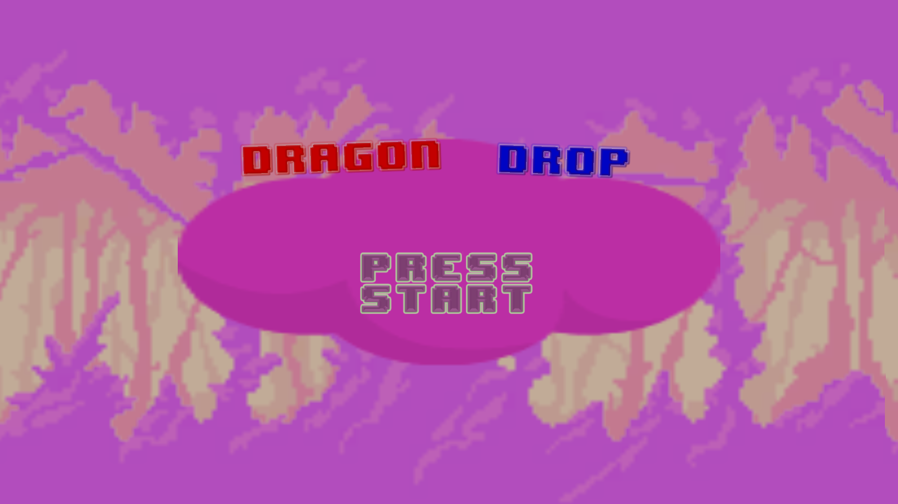
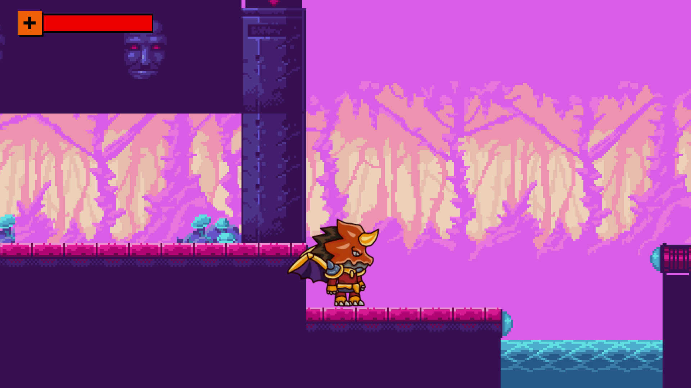
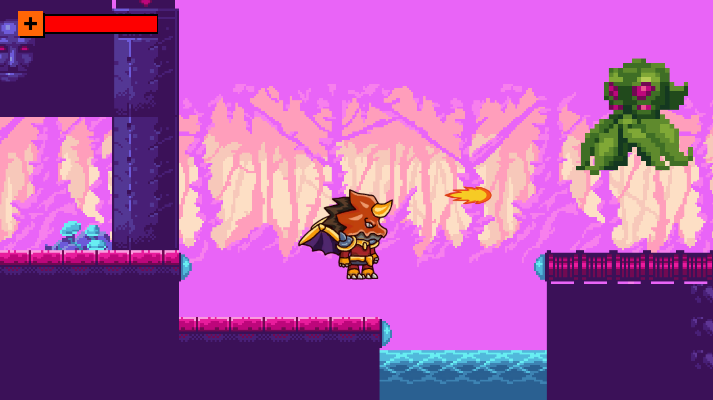
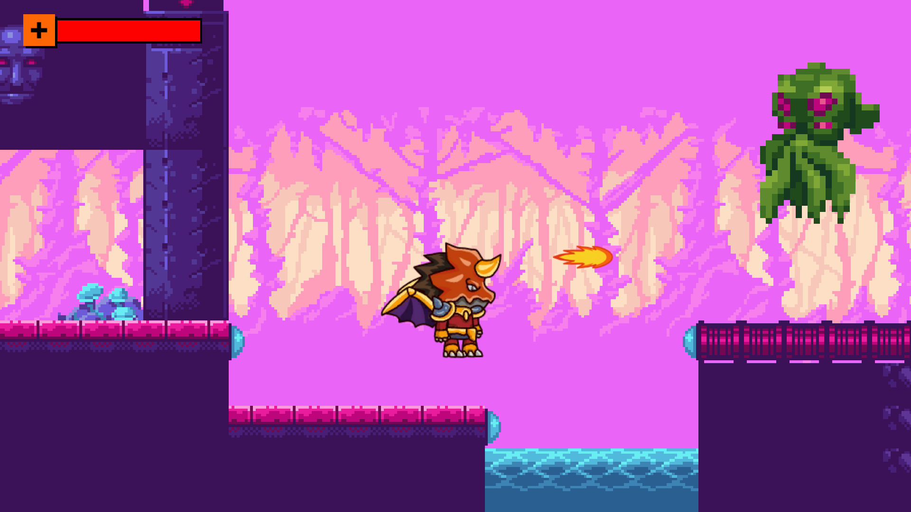
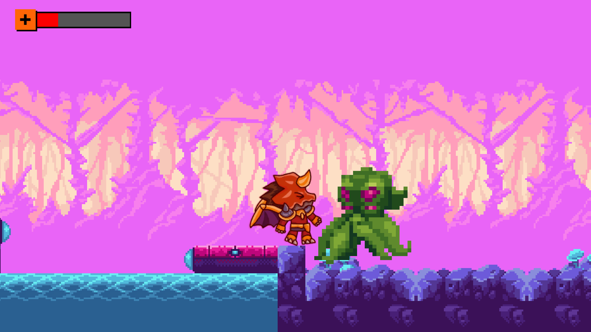

# Dragon Drop
**Dragon Drop** is a retro 2D platformer built with Unity 2019.4 (2D). Play as a Dragon
Warrior–style hero: run, jump, crouch, and fire your way through a single hand-built stage
packed with octopus enemies, and finish the run by taking down the **Jumper** boss.

The whole game is one level — it runs on classic 8-bit aesthetics: pixel-perfect rendering,
a chiptune soundtrack, parallax backgrounds, and an 8-BIT WONDER text font.

## Screenshots

| | | |
|:---:|:---:|:---:|
|  |  |  |
| *Title scene — the animated **Dragon Drop** logo over a parallax forest backdrop; press **Enter** or **Press Start** to begin.* | *The stage opens on the hero: full health bar top-left, the dark tower, and a pool of water hazard.* | *The hero fires a flame projectile — each hit does 1 of 3 hits to an octopus.* |

| | |
|:---:|:---:|
|  |  |
| *Projectile in flight; the octopus drifts back after being struck.* | *Up close and personal — taking a hit from an octopus knocks the hero back and drops the health bar to 1 of 3.* |

## Running the game

- Requires **Unity 2019.4.11f1** (see `ProjectSettings/ProjectVersion.txt`). Open the
  project root in Unity Hub; Unity will import the assets on first open.
- The build contains three scenes, in this order (`ProjectSettings/EditorBuildSettings.asset`):

  | # | Scene | Purpose |
  |---|-------|---------|
  | 0 | `Assets/Scenes/TitleScene.unity` | Main menu — animated "Dragon Drop" title, press **Enter** or click *Press Start* |
  | 1 | `Assets/Scenes/SampleScene.unity` | **The only stage of the game** — the entire playable level |
  | 2 | `Assets/Scenes/Endgame.unity` | "You Win!" victory screen; auto-returns to the title after 8 seconds |

> **The game is one stage.** `Assets/Scenes/SampleScene.unity` is the default and only
> gameplay scene: the whole run is a single level. `TitleScene` is just the menu and
> `Endgame` is just the victory screen — neither contains gameplay.

- To ship a player build, use *File → Build Settings*; this project's local build output
  (`bin/`, `built/`) is git-ignored by design.

## Controls

| Action | Keyboard | Mouse / Gamepad |
|--------|----------|-----------------|
| Move | `←` / `→` or `A` / `D` | Joystick (buttons `0`) |
| Jump | `Space` | Joystick button `3` |
| Crouch | `↓` or `S` | — |
| Fire | `Ctrl` | Left mouse button |
| Start game (title) | `Enter` / `Space` | — |

(Mappings live in `ProjectSettings/InputManager.asset`.)

## How it plays

1. **Title scene** — press start; the game crossfades (black overlay + music fade-out) into
   the stage.
2. **The stage (`SampleScene`)** — the hero has **3 health** with auto-regen (1 per 10 s
   after a hit). Colliding with enemies knocks you back; each hit costs 1 health. Fall off
   the stage or hit 0 health and the run restarts with a crossfade.
   - **Octopus enemies** take 3 hits; they play a death animation and sound.
   - Near the end of the level a trigger arms the **Jumper boss**: it alternates big
     left/right jumps, and its sprite tints green in proportion to remaining health.
3. **Defeat the Jumper** (3 hits) to win — the game crossfades to the *You Win!* screen,
   which loops back to the title.

## Project structure

```
dragon_drop/
├── Assets/
│   ├── Scenes/
│   │   ├── TitleScene.unity      # Main menu (build scene 0)
│   │   ├── SampleScene.unity     # ★ The only stage of the game — the entire level (build scene 1)
│   │   └── Endgame.unity         # "You Win!" victory screen (build scene 2)
│   │
│   ├── Animations/               # All Animator controllers & clips: player (walk/crouch/knockback),
│   │                             # octopus, Jumper boss, bullet, impact, crossfade, UI, + firing.wav
│   ├── BayatGames/
│   │   └── Free Platform Game Assets/   # Third-party pack: backgrounds, characters, enemies, GUI, tiles
│   ├── Dragon Warrior Files/
│   │   ├── Dragon Warrior PNG/   # Player sprite frames (walk, crouch, attack, die)
│   │   ├── Effects/              # Dash-wind effect frames
│   │   ├── Demo.unity            # Asset pack's demo scene
│   │   ├── Dragon Warrior AI.ai  # Source vector artwork
│   │   └── Dragon Warrior EPS.eps
│   ├── Fonts/                    # 8-BIT WONDER TTF, TextMeshPro SDF font, text materials
│   ├── TextMesh Pro/             # TextMeshPro resources
│   ├── Tiles/                    # Tilemap palettes: background_* tile assets, walls-tileset,
│   │                             # Backdrop / Background / New Palette prefabs
│   ├── Warped Caves/             # Third-party environment pack: Artwork/ + demo scene
│   │
│   ├── Scripts (Assets root)     # One file per behaviour — see table below
│   │   ├── CharacterController2D.cs
│   │   ├── Weapon.cs
│   │   ├── BulletLogic.cs
│   │   ├── ImpactEffectLogic.cs
│   │   ├── EnemyScript.cs
│   │   ├── EnemyRoot.cs
│   │   ├── JumperLogic.cs
│   │   ├── JumperBossIdleAnimationScript.cs
│   │   ├── BossTriggerScript.cs
│   │   ├── HealthScript.cs
│   │   ├── Crossfader.cs
│   │   ├── DragonAnimationComplete.cs
│   │   ├── LoadGameScript.cs
│   │   ├── MoveRightScript.cs
│   │   └── parallax.cs
│   ├── Prefabs (Assets root)
│   │   ├── Player.prefab         # The hero (controller, weapon, health, animator)
│   │   ├── Bullet.prefab         # Projectile
│   │   ├── impact.prefab         # Hit impact effect
│   │   ├── Jumper.prefab         # Boss
│   │   ├── OctopusRoot.prefab    # Standard enemy
│   │   └── Crossfader.prefab     # Scene-transition overlay + music fader
│   ├── Audio (Assets root)       # bullet_strike, death, explosion2, hurt,
│   │                             # octopus_death_sound, theme_1, theme_2 (+ .ceol chiptune sources)
│   └── Misc (Assets root)        # dp_logo.png, Overlay.png, UI art, Healthbar_mat.mat,
│                                 # physics materials (Sticky, New Physics Material 2D)
│
├── docs/
│   └── screenshots/              # Screenshots shown above: title-scene, stage-start,
│                                 # firing, combat, close-encounter
│
├── Packages/
│   ├── manifest.json             # Package dependencies (2D stack, Cinemachine, TMP, uGUI, …)
│   └── packages-lock.json
│
├── ProjectSettings/              # Unity 2019.4.11f1 project settings (input, layers, build scenes, …)
└── .gitignore                    # Ignores Library/, Temp/, bin/, built/, etc.
```

### Scripts at a glance

| Script | What it does |
|--------|--------------|
| `CharacterController2D` | Player controller: smoothed run, jump, crouch, firing, knockback + 3 HP with regen; death → crossfade restart. |
| `Weapon` | Instantiates the bullet prefab at the fire point. |
| `BulletLogic` | Projectile: flies at a set velocity, fizzles after ~260 frames, spawns the impact effect and damages the struck enemy. |
| `ImpactEffectLogic` | Destroys the impact effect when its animation finishes. |
| `EnemyScript` | Base enemy: 3 hit points, dying animation flag, virtual `Die()`. |
| `EnemyRoot` | Routes `Die()` to self/children and plays the death sound. |
| `JumperLogic` | Boss: alternates left/right jumps; on death fades the game out to the `Endgame` scene. |
| `JumperBossIdleAnimationScript` | `StateMachineBehaviour` that tints the boss sprite green in proportion to remaining HP. |
| `BossTriggerScript` | Trigger zone that activates the Jumper when the player walks in. |
| `HealthScript` | Binds the UI health-bar slider to the player's health each frame. |
| `Crossfader` | Scene-transition helper: black overlay fade + 1.3 s music fade-out, then loads the target scene. |
| `DragonAnimationComplete` | In the victory scene, loops back to scene 0 (the title) after 8 s. |
| `LoadGameScript` | Title-screen start: Enter/Space fades into `SampleScene`. |
| `MoveRightScript` | Applies a constant rightward velocity to its rigidbody. |
| `parallax` | Scroll-wrapping parallax for background sprites, scaled by camera movement. |

### Packages

`Packages/manifest.json` pulls the standard 2D stack plus: **2D Animation**, **2D Pixel
Perfect** (pixel-perfect camera), **2D Tilemap**, **2D Sprite/Shape**, **Cinemachine**
(virtual camera), **TextMeshPro**, **uGUI**, **Timeline**, and the Unity Test Framework.

## Audio

All music is chiptune: `theme_1` and `theme_2` ship with their `.ceol` source files, so
they can be re-edited in a CEOL tracker and re-rendered. SFX cover firing, hits, deaths,
and explosions.

## Third-party assets

- **BayatGames — Free Platform Game Assets** (`Assets/BayatGames/`)
- **Warped Caves** (`Assets/Warped Caves/`)
- **Dragon Warrior sprite files** (`Assets/Dragon Warrior Files/`) — includes the source
  vector artwork (`.ai` / `.eps`)
- **8-BIT WONDER** font (`Assets/Fonts/`)
